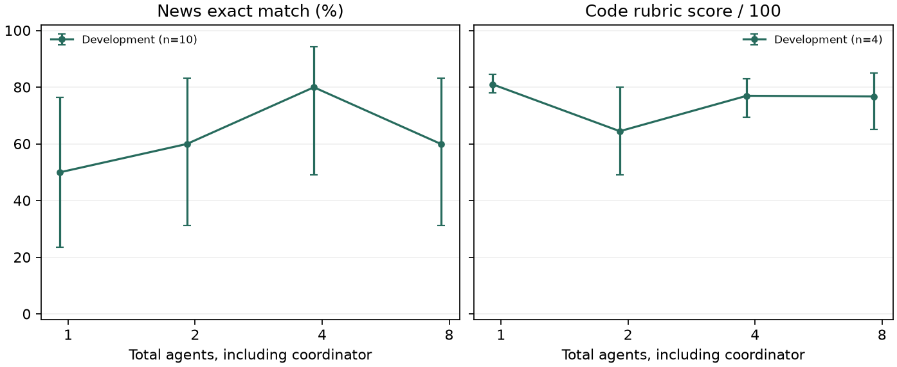
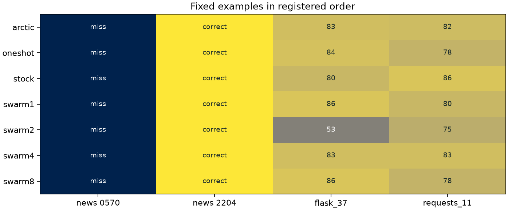

# Luna folder research swarm

A private experiment in answering questions from files. Independent GPT-6 Luna investigators use Codex to search a read-only folder. A coordinator checks their source excerpts and writes a cited answer. The experiment varies the total number of agents and measures answer quality, evidence support, time, and API cost on news and Python repositories.

<!-- result-headline -->
## Current held-out results

**2026-11-19 19:52 UTC.** The study has recorded **1,228/2,350 evaluations (52.3%)**. All five methods have scores on 244 questions. The development sweep selected 4 total agents, including the coordinator.

| Matched panel | Questions | 4-agent swarm | One agent | Stock Codex | Arctic single agent | One-shot RAG |
| --- | --- | --- | --- | --- | --- | --- |
| News, first attempts | 165 | 123/165 | 112/165 | 136/165 | 128/165 | 118/165 |
| News, outage-free | 160 | 123/160 | 112/160 | 136/160 | 126/160 | 117/160 |
| Code, first attempts | 79 | 75.96 | 74.39 | 79.33 | 80.37 | 67.75 |
| Code, outage-free | 76 | 77.89 | 77.33 | 81.28 | 82.39 | 68.43 |

News cells count exact matches. Code cells give the mean blinded rubric score out of 100. The primary scores retain 30 provider-overload failures. The outage-free rows exclude a question from all five methods whenever any arm had a recorded overload failure. [Paired outage analysis](reports/experiments/availability.md)

Across 140 outage-free news questions with annotated sources, the swarm cited 86.4% of the reference files per question on average. One agent cited 78.0% and stock Codex cited 82.5%. [Citation and claim-support measurements](reports/experiments/grounding.md)

On the 160 matched outage-free news questions, the swarm took a median **139 seconds** at a mean upper cost of **$0.0171 per question**. Stock Codex took **70 seconds** at **$0.0052**.

The study ledger shows **$9.56 settled** and **$3.59 reserved** against the $50 ceiling. The fixed evidence audit has 0/235 records. [Live local dashboard](http://127.0.0.1:8765) · [Private explorer](https://huggingface.co/spaces/BurnyCoder/luna-folder-swarm-explorer)

The registered comparison is in progress. The available scores are descriptive. [Measured tables](results/tables.md)
<!-- /result-headline -->

The starting observation comes from a small, model-specific study. Its single agent outscored its swarm on repository questions. Its filename-recall measure leaves open whether an agent saw a passage that substantiates the answer. The present comparison holds the generation model fixed, includes ordinary Codex and one-shot retrieval, and measures passage delivery. [Arctic results](https://github.com/BurnyCoder/arcticswarm-folder-rag-research/blob/bd5b3ed98cde10e9c1f90795f2182d84ecd51ddc/results/day1/tables.md) · [Original collector](https://github.com/BurnyCoder/arcticswarm-folder-rag-research/blob/bd5b3ed98cde10e9c1f90795f2182d84ecd51ddc/src/folderrag/collect.py#L78)

## Research record

- [Experiment inventory with types, progress, and planned controls](reports/experiments/inventory.md)
- [Literature review](reports/literature-review.md) and [state of the art](reports/state-of-the-art-review.md)
- [Preregistration](reports/preregistration.md) and [implementation plan](reports/plan.md)
- [Development amendments](reports/development-amendments.md), [CLI checks](reports/experiments/cli-smoke.md) and [archived Haiku answers under the common scorer](reports/experiments/historical.md)
- [Private collection and encoder](https://huggingface.co/collections/BurnyCoder/luna-folder-swarm-research-6afef1463801afdd0f8b15c0) and [private research artifacts and transcripts](https://huggingface.co/datasets/BurnyCoder/luna-folder-swarm-results)

## Reproduction

The runtime is Linux with bubblewrap, ripgrep, Codex CLI, Python 3.12 and uv. Windows users can run it with WSL2. A GPU accelerates the local Qwen embedding encoder. Keep the OpenAI API key in an ignored project-root `.env`. The host process handles credentials. Each research arm receives only its question and permitted corpus. The budget covers all paid inference and grading for this study. [Codex CLI](https://learn.chatgpt.com/docs/non-interactive-mode) · [Luna](https://developers.openai.com/api/docs/models/gpt-6-luna) · [Qwen model card](https://huggingface.co/Qwen/Qwen3-Embedding-0.6B)

Run `uv run folderrag ask --folder PATH --agents 4 "QUESTION"`. Choose 1, 2, 4 or 8 total agents. At size four, three independent investigators gather evidence and one coordinator verifies quotations and produces the answer. Add `--json` for the answer, citations, offsets, worker completions, time and cost.

[Installation, live dashboard and reproduction commands](docs/usage.md) · [Frozen question manifest](protocol/splits.json) · [Private results and examples](https://huggingface.co/spaces/BurnyCoder/luna-folder-swarm-explorer)

## Research milestones

- [x] Register the protocol and ordered, stratified evaluation design.
- [x] Implement the swarm, four sizes, baselines, cost ledger, and source validation.
- [x] Complete the development sweep and freeze the candidate size and affordable test set.
- [ ] Complete the paired confirmation, controls, intervention tests and evidence audit.

<!-- generated -->
## Measured results

Each row uses every graded response available for that method. During collection, methods can have different question counts. Run `uv run folderrag report` to regenerate this snapshot from the saved records.

| Phase | Domain | Method | Graded / attempts | Quality [95% CI] | USD/question¹ | Median / p95 s | Errors |
|---|---|---|---:|---:|---:|---:|---:|
| dev | code | arctic | 10 / 10 | 83.1 [81.3, 85.0] | 0.0032 | 39.1 / 136.2 | 0 |
| dev | code | oneshot | 10 / 10 | 78.7 [73.3, 82.9] | 0.0008 | 7.9 / 13.3 | 0 |
| dev | code | stock | 10 / 10 | 81.1 [75.9, 85.3] | 0.0042 | 78.2 / 125.3 | 0 |
| dev | code | swarm1 | 10 / 10 | 82.6 [80.0, 85.4] | 0.0041 | 47.6 / 111.2 | 0 |
| dev | code | swarm2 | 10 / 10 | 71.6 [61.6, 80.6] | 0.0082 | 98.5 / 262.4 | 0 |
| dev | code | swarm4 | 10 / 10 | 75.1 [66.7, 82.3] | 0.0172 | 135.3 / 238.0 | 0 |
| dev | code | swarm8 | 10 / 10 | 78.9 [72.8, 84.2] | 0.0219 | 112.1 / 253.9 | 0 |
| dev | news | arctic | 10 / 10 | 70.0% [39.7%, 89.2%] | 0.0074 | 41.5 / 97.1 | 0 |
| dev | news | oneshot | 10 / 10 | 70.0% [39.7%, 89.2%] | 0.0007 | 6.7 / 8.3 | 0 |
| dev | news | stock | 10 / 10 | 90.0% [59.6%, 98.2%] | 0.0054 | 63.1 / 126.0 | 0 |
| dev | news | swarm1 | 10 / 10 | 50.0% [23.7%, 76.3%] | 0.0060 | 87.7 / 120.4 | 0 |
| dev | news | swarm2 | 10 / 10 | 60.0% [31.3%, 83.2%] | 0.0091 | 154.1 / 251.0 | 0 |
| dev | news | swarm4 | 10 / 10 | 80.0% [49.0%, 94.3%] | 0.0182 | 179.0 / 228.5 | 0 |
| dev | news | swarm8 | 10 / 10 | 60.0% [31.3%, 83.2%] | 0.0222 | 148.3 / 225.8 | 0 |
| test | code | arctic | 79 / 79 | 80.4 [76.7, 83.3] | 0.0055 | 55.1 / 140.9 | 2 |
| test | code | oneshot | 81 / 81 | 67.9 [63.7, 71.9] | 0.0008 | 9.2 / 18.0 | 0 |
| test | code | stock | 80 / 80 | 79.2 [75.5, 82.3] | 0.0046 | 71.4 / 123.0 | 2 |
| test | code | swarm1 | 81 / 81 | 74.5 [70.3, 78.2] | 0.0055 | 74.7 / 177.8 | 3 |
| test | code | swarm4 | 79 / 79 | 76.0 [72.0, 79.2] | 0.0172 | 145.5 / 238.6 | 2 |
| test | news | arctic | 166 / 166 | 77.7% [70.8%, 83.4%] | 0.0066 | 36.2 / 74.3 | 3 |
| test | news | oneshot | 166 / 166 | 71.7% [64.4%, 78.0%] | 0.0008 | 7.7 / 12.0 | 4 |
| test | news | stock | 166 / 166 | 82.5% [76.0%, 87.6%] | 0.0052 | 70.4 / 111.1 | 5 |
| test | news | swarm1 | 165 / 165 | 67.9% [60.4%, 74.5%] | 0.0075 | 75.0 / 167.1 | 5 |
| test | news | swarm4 | 165 / 165 | 74.5% [67.4%, 80.6%] | 0.0174 | 137.6 / 207.9 | 4 |

¹ Conservative inference charge using the cache-write upper rate for unclassified input tokens. Grading is included in the phase ledger.

[Read the actual answers and source quotations](reports/experiments/output-examples.md)

[Paper](reports/paper.pdf) · [All experiment reports](reports/summary.md)
