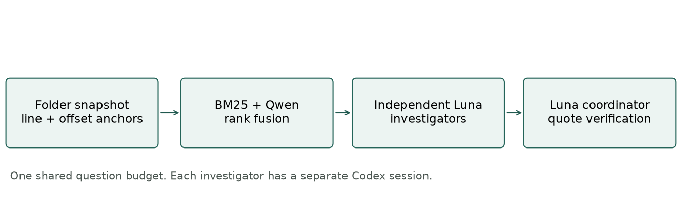

# Luna folder research swarm

A private experiment in answering questions from files. Independent GPT-6 Luna investigators use Codex to search a read-only folder. A coordinator checks their source excerpts and writes a cited answer. The experiment varies the total number of agents and measures answer quality, evidence support, time, and API cost on news and Python repositories.

The starting observation comes from a small, model-specific study. Its single agent outscored its swarm on repository questions. Its filename-recall measure leaves open whether an agent saw a passage that substantiates the answer. The present comparison holds the generation model fixed, includes ordinary Codex and one-shot retrieval, and measures passage delivery. [Arctic results](https://github.com/BurnyCoder/arcticswarm-folder-rag-research/blob/bd5b3ed98cde10e9c1f90795f2182d84ecd51ddc/results/day1/tables.md) · [Original collector](https://github.com/BurnyCoder/arcticswarm-folder-rag-research/blob/bd5b3ed98cde10e9c1f90795f2182d84ecd51ddc/src/folderrag/collect.py#L78)

## Research record

- [Literature review](reports/literature-review.md) and [state of the art](reports/state-of-the-art-review.md)
- [Preregistration](reports/preregistration.md) and [implementation plan](reports/plan.md)

## Reproduction

The runtime is Linux with bubblewrap, ripgrep, Codex CLI, Python 3.12 and uv. Windows users can run it with WSL2. A GPU accelerates the local Qwen embedding encoder. Keep the OpenAI API key in an ignored project-root `.env`. The host process handles credentials. Each research arm receives only its question and permitted corpus. The budget covers all paid inference and grading for this study. [Codex CLI](https://learn.chatgpt.com/docs/non-interactive-mode) · [Luna](https://developers.openai.com/api/docs/models/gpt-6-luna) · [Qwen model card](https://huggingface.co/Qwen/Qwen3-Embedding-0.6B)

Run `uv run folderrag ask --folder PATH --agents 4 "QUESTION"`. Choose 1, 2, 4 or 8 total agents. At size four, three independent investigators gather evidence and one coordinator verifies quotations and produces the answer. Add `--json` for the answer, citations, offsets, worker completions, time and cost.

[Installation, live dashboard and reproduction commands](docs/usage.md) · [Frozen question manifest](protocol/splits.json) · [Private results and examples](https://huggingface.co/spaces/BurnyCoder/luna-folder-swarm-explorer)

## Research milestones

- [x] Register the protocol and ordered, stratified evaluation design.
- [x] Implement the swarm, four sizes, baselines, cost ledger, and source validation.
- [ ] Complete the development sweep and freeze the candidate size and affordable test set.
- [ ] Complete the paired confirmation, controls, intervention tests and evidence audit.

<!-- generated -->
## Measured results

The protocol and implementation are available. Paired experiments are pending.

| Phase | Domain | Method | Graded / attempts | Quality [95% CI] | USD/question¹ | Median / p95 s | Errors |
|---|---|---|---:|---:|---:|---:|---:|
| Pending | | | | | | | |

¹ Conservative inference charge using the cache-write upper rate for unclassified input tokens. Grading is included in the phase ledger.

[Paper](reports/paper.pdf) · [All experiment reports](reports/summary.md)
