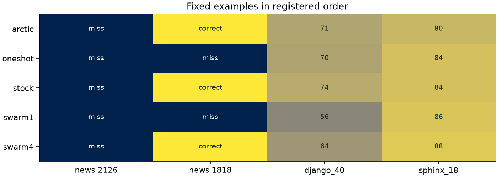

# Fixed output examples

Cases are selected in the split manifest's stored order. A dash in the figure denotes an unobserved condition. News cells show strict exact match and code cells show the score out of 100.



## mhr_2126

Did the approach to presenting prop bets to bettors by Sporting News change between the report on NBA prop bets published on October 2, 2023, and the report on NCAAF bowl season prop bets published later?

**Benchmark reference**

no

### arctic

Recorded score 0 / 1.

Yes

The October 2 NBA report takes an instructional approach: it explains team and player props, how to read their odds, and how to bet them. The later bowl-season report treats props more briefly within a bowl-odds roundup: it gives examples of bowl props and points readers to separate touchdown-prop coverage for specific games. So the presentation changed from a detailed general guide to brief, event-specific signposting and a general definition.

> Published: 2023-10-02T23:49:35+00:00

sporting-news/2023-10-02_nba-prop-bets-best-team-and-player-props-2023-24-season.md · verified

> How to read NBA props odds

sporting-news/2023-10-02_nba-prop-bets-best-team-and-player-props-2023-24-season.md · verified

> Using multiple sportsbook accounts lets you find the best odds for every NBA prop bet.

sporting-news/2023-10-02_nba-prop-bets-best-team-and-player-props-2023-24-season.md · verified

> Published: 2023-12-15T20:37:00+00:00

sporting-news/2023-12-15_college-bowl-odds-spreads-money-lines-and-totals-ncaaf-2023.md · verified

> Interested in Touchdown props? Click here!

sporting-news/2023-12-15_college-bowl-odds-spreads-money-lines-and-totals-ncaaf-2023.md · verified

> Bowl game props: These can be team or individual player prop bets

sporting-news/2023-12-15_college-bowl-odds-spreads-money-lines-and-totals-ncaaf-2023.md · verified

### oneshot

Recorded score 0 / 1.

Yes.

The October NBA report presents props as the subject of a dedicated guide: it defines them, gives numerous player and team examples, and explains how to bet on them. The later NCAAF bowl report treats props more briefly as one option among several bowl bet types, with a couple of examples. So the presentation shifted from an in-depth, sport-specific guide to a concise overview within a broader bowl-betting guide.

> Some examples of NBA player props are:

sporting-news/2023-10-02_nba-prop-bets-best-team-and-player-props-2023-24-season.md · verified

> Tips for betting on NBA props

sporting-news/2023-10-02_nba-prop-bets-best-team-and-player-props-2023-24-season.md · verified

> These can be team or individual player prop bets, such as which team is winning at halftime or the total number of receptions a player collects.

sporting-news/2023-12-15_college-bowl-odds-spreads-money-lines-and-totals-ncaaf-2023.md · verified

### stock

Recorded score 0 / 1.

Yes

The October 2 report is a dedicated NBA prop-betting guide: it gives player and team prop examples, explains prop types, and offers betting tips. The December 15 bowl-season report presents props as one part of a broader bowl-odds article. It defines bowl props with general examples and points readers to separate Rose Bowl and Sugar Bowl touchdown-prop pages for more detail.

> Some examples of NBA player props are:

sporting-news/2023-10-02_nba-prop-bets-best-team-and-player-props-2023-24-season.md · verified

> Tips for betting on NBA props

sporting-news/2023-10-02_nba-prop-bets-best-team-and-player-props-2023-24-season.md · verified

> Bowl game props: These can be team or individual player prop bets, such as which team is winning at halftime or the total number of receptions a player collects.

sporting-news/2023-12-15_college-bowl-odds-spreads-money-lines-and-totals-ncaaf-2023.md · verified

> For more on the opening lines for the Rose Bowl click here! Interested in Touchdown props? Click here!

sporting-news/2023-12-15_college-bowl-odds-spreads-money-lines-and-totals-ncaaf-2023.md · verified

### swarm1

Recorded score 0 / 1.

Insufficient information

The bowl report frames prop bets as part of the broader range of markets around bowl, playoff, and championship odds. The bowl report briefly defines props within its list of bowl betting markets, using team and player examples. The bowl report points readers to separate touchdown prop coverage. Unsupported: The NBA report introduces props as an easy entry point and emphasizes their variety across players and teams.

> NBA prop bets are an easy way to jump into basketball betting. Proposition bets, or props, are easy to understand, numerous, and cover both player props and team props to give you plenty of variety.

sporting-news/2023-10-02_nba-prop-bets-best-team-and-player-props-2023-24-season.md · unverified

> Along with game odds, sportsbooks will offer a wider variety of prop bets to match the hype surrounding College Bowl odds, the College Football Playoff, and National Championship games.

sporting-news/2023-12-15_college-bowl-odds-spreads-money-lines-and-totals-ncaaf-2023.md · verified

> Bowl game props: These can be team or individual player prop bets, such as which team is winning at halftime or the total number of receptions a player collects.

sporting-news/2023-12-15_college-bowl-odds-spreads-money-lines-and-totals-ncaaf-2023.md · verified

> Interested in Touchdown props? Click here!

sporting-news/2023-12-15_college-bowl-odds-spreads-money-lines-and-totals-ncaaf-2023.md · verified

### swarm4

Recorded score 0 / 1.

Yes

The October 2 NBA report took an instructional approach: it categorized team and player props and gave bettors a dedicated section of practical advice, including checking player news and injuries, tracking usage and minutes, and comparing sportsbook lines. The later NCAAF bowl season report presented props as part of the broader bowl odds coverage, briefly defined them with team and player examples, and linked readers to separate touchdown prop coverage for specific playoff bowls.

> Published: 2023-10-02T23:49:35+00:00

sporting-news/2023-10-02_nba-prop-bets-best-team-and-player-props-2023-24-season.md · verified

> Tips for betting on NBA props

Every bettor should develop their strategies, but we do have three tips you can use for NBA props.

sporting-news/2023-10-02_nba-prop-bets-best-team-and-player-props-2023-24-season.md · verified

> Pay attention to player and team news: Oddsmakers use various information to develop their lines for games and players, and you should, too.

sporting-news/2023-10-02_nba-prop-bets-best-team-and-player-props-2023-24-season.md · verified

> Published: 2023-12-15T20:37:00+00:00

sporting-news/2023-12-15_college-bowl-odds-spreads-money-lines-and-totals-ncaaf-2023.md · verified

> Bowl game props: These can be team or individual player prop bets, such as which team is winning at halftime or the total number of receptions a player collects.

sporting-news/2023-12-15_college-bowl-odds-spreads-money-lines-and-totals-ncaaf-2023.md · verified

> Interested in Touchdown props? Click here!

sporting-news/2023-12-15_college-bowl-odds-spreads-money-lines-and-totals-ncaaf-2023.md · verified

## mhr_1818

Before the report by The Age on October 22, 2023, which maintained that Google manipulates Search to maximise ad revenue, and the subsequent report by TechCrunch on November 13, 2023, detailing Google's expenditure to be the default search engine, was there inconsistency in the portrayal of Google's business practices in the TechCrunch article published on December 15, 2023, regarding the class action antitrust suit against Google?

**Benchmark reference**

no

### arctic

Recorded score 1 / 1.

No

The December 15 article presents allegations and Google’s response as opposing attributed positions, rather than making contradictory claims itself. The Age discussed an allegation that Google manipulates searches to maximize ad revenue, while also reporting Google’s denial; TechCrunch’s November 13 article described the $26.3 billion default-search payments and other default-setting agreements. The December article focuses on a separate publisher lawsuit alleging that Google’s use of publisher content and AI products diverts readers and ad revenue, and also reports Google’s claim that it sends publishers substantial traffic at no cost. Those points are in tension, but the article identifies who is making each claim; the files do not establish an inconsistency in its portrayal.

> maintains that Google manipulates Search to maximise ad revenue

the-age/2023-10-22_is-google-search-better-than-the-rest-and-is-that-fair.md · verified

> Google spent $26.3 billion in 2021 making itself the default search engine across platforms

techcrunch/2023-11-13_more-from-the-us-v-google-trial-vertical-search-pre-installs.md · verified

> argues that Google “siphons off” news publishers’ content, their readers and ad revenue

techcrunch/2023-12-15_news-publisher-files-class-action-antitrust-suit-against-goo.md · verified

> Google links people to publishers’ websites more than 24 billion times each month – at no cost to them.

techcrunch/2023-12-15_news-publisher-files-class-action-antitrust-suit-against-goo.md · verified

> The case points to other concerns, too, like changing AdSense rates

techcrunch/2023-12-15_news-publisher-files-class-action-antitrust-suit-against-goo.md · verified

### oneshot

Recorded score 0 / 1.

No clear inconsistency

The December 15 article describes allegations in a news-publisher lawsuit: that Google takes publishers’ content, readers, and ad revenue, with AI products worsening the harm. The article also distinguishes that dispute from Google’s search-default payments and from separate digital-ad-tech litigation. Those are different alleged practices and markets, so the supplied evidence does not show a contradiction in the portrayal. The Age article itself is not included, so its exact wording cannot be independently compared.

> The case, filed by Arkansas-based publisher Helena World Chronicle, argues that Google “siphons off” news publishers’ content, their readers and ad revenue through anticompetitive means. It also specifically cites new AI technologies

techcrunch/2023-12-15_news-publisher-files-class-action-antitrust-suit-against-goo.md · verified

> references the 2020 Justice Department’s civil antitrust suit over search and search advertising (which are different markets from digital ad technologies in the more recent suit).

techcrunch/2023-12-15_news-publisher-files-class-action-antitrust-suit-against-goo.md · verified

> we learned how Google spent $26.3 billion in 2021 making itself the default search engine across platforms

techcrunch/2023-11-13_more-from-the-us-v-google-trial-vertical-search-pre-installs.md · verified

### stock

Recorded score 1 / 1.

No

The December 15 article describes additional alleged practices affecting publishers; they do not contradict the earlier accounts. The Age reported Megan Grey’s allegation that Google manipulates Search to maximize ad revenue, while also noting Google denied steering users toward more monetizable topics. TechCrunch’s November 13 report focused on Google’s spending to become the default search engine and allegations that its partner deals blocked competition. The December 15 report focused on publishers’ claims that Google uses their content and AI features to divert traffic and revenue, and mentions AdSense rates. These are distinct, compatible allegations, not findings that the articles present as proven facts.

> maintains that Google manipulates Search to maximise ad revenue

the-age/2023-10-22_is-google-search-better-than-the-rest-and-is-that-fair.md · verified

> Google spent $26.3 billion in 2021 making itself the default search engine across platforms

techcrunch/2023-11-13_more-from-the-us-v-google-trial-vertical-search-pre-installs.md · verified

> Google “siphons off” news publishers’ content, their readers and ad revenue through anticompetitive means.

techcrunch/2023-12-15_news-publisher-files-class-action-antitrust-suit-against-goo.md · verified

> like changing AdSense rates

techcrunch/2023-12-15_news-publisher-files-class-action-antitrust-suit-against-goo.md · verified

### swarm1

Recorded score 0 / 1.

No clear inconsistency.

The reports describe different, compatible allegations. The Age attributes the claim that Google manipulates Search to maximize ad revenue to Megan Gray, while noting she may have misread the evidence and that Google denied steering users toward more monetizable subjects. TechCrunch’s November report describes Google’s $26.3 billion in payments to become the default search engine. Its December article reports publishers’ separate allegations that Google takes their content, readers, and ad revenue, including through AI and search features; it also includes Google’s response. The December article distinguishes the publishers’ case from the DOJ cases, which concern different markets. The December framing may emphasize the publishers’ allegations, but the cited accounts do not establish a contradiction in the underlying portrayal of Google’s practices.

> She admits that she may have misinterpreted the evidence, but maintains that Google manipulates Search to maximise ad revenue.

the-age/2023-10-22_is-google-search-better-than-the-rest-and-is-that-fair.md · verified

> But Google denies pushing users towards the most monetisable subjects.

the-age/2023-10-22_is-google-search-better-than-the-rest-and-is-that-fair.md · verified

> Google spent $26.3 billion in 2021 making itself the default search engine across platforms

techcrunch/2023-11-13_more-from-the-us-v-google-trial-vertical-search-pre-installs.md · verified

> The case, filed by Arkansas-based publisher Helena World Chronicle, argues that Google “siphons off” news publishers’ content, their readers and ad revenue through anticompetitive means.

techcrunch/2023-12-15_news-publisher-files-class-action-antitrust-suit-against-goo.md · verified

> search and search advertising (which are different markets from digital ad technologies in the more recent suit).

techcrunch/2023-12-15_news-publisher-files-class-action-antitrust-suit-against-goo.md · verified

> Google links people to publishers’ websites more than 24 billion times each month – at no cost to them.

techcrunch/2023-12-15_news-publisher-files-class-action-antitrust-suit-against-goo.md · verified

### swarm4

Recorded score 1 / 1.

No

The December 15 article reports allegations in a different case: that Google takes publishers’ content, readers, and ad revenue. It attributes those claims to the publisher’s lawsuit, gives Google’s response, and explicitly distinguishes that case from the separate digital ad technology and search advertising suits. Those accounts can coexist with The Age’s report of an allegation about Search monetization and TechCrunch’s report of payments for default placement; the articles do not portray those practices as mutually exclusive.

> maintains that Google manipulates Search to maximise ad revenue

the-age/2023-10-22_is-google-search-better-than-the-rest-and-is-that-fair.md · verified

> Google spent $26.3 billion in 2021 making itself the default search engine across platforms

techcrunch/2023-11-13_more-from-the-us-v-google-trial-vertical-search-pre-installs.md · verified

> argues that Google “siphons off” news publishers’ content, their readers and ad revenue through anticompetitive means

techcrunch/2023-12-15_news-publisher-files-class-action-antitrust-suit-against-goo.md · verified

> which are different markets from digital ad technologies in the more recent suit

techcrunch/2023-12-15_news-publisher-files-class-action-antitrust-suit-against-goo.md · verified

> Google links people to publishers’ websites more than 24 billion times each month – at no cost to them.

techcrunch/2023-12-15_news-publisher-files-class-action-antitrust-suit-against-goo.md · verified

## sweqa_django_40

Where does the cascade deletion triggered by the ForeignKey relationship in silly_tribble propagate through the data control flow when a referenced Tribble instance is deleted?

**Benchmark reference**

The cascade deletion triggered by the foreign key in the unmigrated test app model propagates through the data control flow in the following sequence when a referenced migration-defined model instance is deleted:

**1. Entry Point - Model.delete() method** (`django/db/models/base.py`, lines 1231-1240):
   - When a model instance's `delete()` method is called, it creates a `Collector` instance and calls `collector.collect([self])` to begin the collection phase.

**2. Collection Phase - Collector.collect() method** (`django/db/models/deletion.py`, lines 244-396):
   - The `collect()` method adds the object to be deleted to `self.data` (a defaultdict mapping models to sets of instances).
   - It then calls `get_candidate_relations_to_delete()` (lines 84-91) to find all reverse relations (one-to-many and one-to-one) that point to the model being deleted.
   - For each candidate relation, it calls `related_objects()` (lines 398-406) to query for related model instances using a filter predicate like `{related_field.name}__in: objs`.
   - For the specific case: when a `Tribble` instance is deleted, `get_candidate_relations_to_delete()` finds the reverse relation from `Tribble` to `SillyModel` (created automatically for the `silly_tribble` ForeignKey).
   - `related_objects()` queries for all `SillyModel` instances where `silly_tribble` points to the deleted `Tribble` instance.

**3. CASCADE Handler** (`django/db/models/deletion.py`, lines 22-31):
   - When a related field has `on_delete=CASCADE`, the `CASCADE()` function is called with the collector, field, and related objects.
   - The `CASCADE()` function recursively calls `collector.collect(sub_objs, source=field.remote_field.model, ...)` to add the related objects (e.g., `SillyModel` instances) to the collection for deletion.
   - This creates a recursive propagation: if those `SillyModel` instances have their own CASCADE relationships, those will also be collected.

**4. Dependency Tracking** (`django/db/models/deletion.py`, lines 116-138, 140-146):
   - As objects are collected, the `add()` method tracks deletion-order dependencies via `self.dependencies` to ensure objects are deleted in the correct order (child models before parent models when there are non-nullable relationships).

**5. Deletion Phase - Collector.delete() method** (`django/db/models/deletion.py`, lines 431-517):
   - After collection is complete, `collector.delete()` is called.
   - It sorts objects by dependencies using `sort()` (lines 413-429) to determine deletion order.
   - Within a database transaction (`transaction.atomic()`), it:
     a. Sends `pre_delete` signals for each object (lines 456-463)
     b. Performs fast deletes for querysets that can be deleted without fetching into memory (lines 466-469)
     c. Updates fields for SET_NULL/SET_DEFAULT handlers (lines 472-491)
     d. Deletes instances in dependency order using `sql.DeleteQuery.delete_batch()` (lines 498-503)
     e. Sends `post_delete` signals for each deleted object (lines 505-512)

**Data Control Flow Summary:**
The propagation follows this path: `Model.delete()` → `Collector.__init__()` → `Collector.collect()` → `get_candidate_relations_to_delete()` → `Collector.related_objects()` → `CASCADE()` → recursive `Collector.collect()` → `Collector.delete()` → `sql.DeleteQuery.delete_batch()` → actual SQL DELETE statements.

For the specific case of `silly_tribble` referencing `Tribble`: when a `Tribble` instance is deleted, the cascade propagates by finding all `SillyModel` instances via the reverse relation, adding them to the collector through the CASCADE handler, and then deleting them in the same transaction after the `Tribble` instance is deleted (respecting dependency order).

### arctic

Recorded score 71 / 100.

unmigrated_app.SillyModel

In the intended cascade path, deleting a Tribble instance starts a Collector from Model.delete(); the collector finds reverse ForeignKey relations, queries related SillyModel rows, and invokes the ForeignKey’s CASCADE handler. That handler recursively collects those rows, which the collector then deletes (possibly through its fast-delete path). Important fixture caveat: the repository says this SillyModel foreign key points to a Tribble defined only in a migration, so the global app registry never sees Tribble and the reference is left dangling. Thus the code establishes the intended cascade destination, but not a live runtime cascade for this fixture.

> silly_tribble = models.ForeignKey("migrations.Tribble", models.CASCADE)

tests/migrations/migrations_test_apps/unmigrated_app/models.py · verified

> collector = Collector(using=using, origin=self)

django/db/models/base.py · verified

> for related in get_candidate_relations_to_delete(model._meta):

django/db/models/deletion.py · verified

> collector.collect(

django/db/models/deletion.py · verified

> count = qs._raw_delete(using=self.using)

django/db/models/deletion.py · verified

> the global app registry never sees it and the reference is left dangling.

tests/migrations/test_commands.py · unverified

### oneshot

Recorded score 70 / 100.

SillyModel

Deleting a referenced Tribble cascades to each SillyModel row whose silly_tribble ForeignKey points to it. The evidence does not establish any further application-level propagation beyond those related rows; Django sends deletion signals for cascaded objects, but does not call their Model.delete() methods.

> silly_tribble = models.ForeignKey("migrations.Tribble", models.CASCADE)

tests/migrations/migrations_test_apps/unmigrated_app/models.py · verified

> Cascade deletes. Django emulates the behavior of the SQL constraint ON DELETE CASCADE and also deletes the object containing the ForeignKey. :meth:`.Model.delete` isn't called on related models

docs/ref/models/fields.txt · unverified

### stock

Recorded score 74 / 100.

Django’s deletion Collector

For a ForeignKey configured with CASCADE, deleting a Tribble instance calls Model.delete(), which starts a Collector. The Collector follows reverse relationships, queries the related model for rows whose ForeignKey points to the Tribble, and invokes that field’s on_delete handler. CASCADE feeds those rows back into the Collector, which recursively discovers further cascades. The collected rows are then deleted, with fast-delete paths available; the normal path sends delete signals and issues SQL deletes. The mounted repository has no `silly_tribble` app or Tribble model, so it does not establish which specific related models or further branches are involved.

> collector.collect([self], keep_parents=keep_parents)
        return collector.delete()

django/db/models/base.py · verified

> for related in get_candidate_relations_to_delete(model._meta):

django/db/models/deletion.py · verified

> [(f"{related_field.name}__in", objs) for related_field in related_fields]

django/db/models/deletion.py · verified

> collector.collect(
        sub_objs,

django/db/models/deletion.py · verified

> count = query.delete_batch(pk_list, self.using)

django/db/models/deletion.py · verified

### swarm1

Recorded score 56 / 100.

Insufficient information

SillyModel’s `silly_tribble` field references `migrations.Tribble` with CASCADE. The collector finds reverse related objects for candidate foreign-key relations and runs each field’s on_delete handler. The related-object lookup filters the related model by the foreign-key field against the objects being deleted. The collector invokes the field’s on_delete handler on the related rows. Unsupported: Deleting a model instance starts collection from that instance and then deletes through the collector.; CASCADE recursively collects those related rows.; Deletion is bulk and cascaded models’ delete methods are not called, but deletion signals are sent.; The unmigrated_app test says the Tribble reference is dangling in the global app registry.

> silly_tribble = models.ForeignKey("migrations.Tribble", models.CASCADE)

tests/migrations/migrations_test_apps/unmigrated_app/models.py · verified

> collector.collect([self], keep_parents=keep_parents)\n        return collector.delete()

django/db/models/base.py · unverified

> sub_objs = self.related_objects(related_model, [field], batch)

django/db/models/deletion.py · verified

> return related_model._base_manager.using(self.using).filter(predicate)

django/db/models/deletion.py · verified

> on_delete(self, field, sub_objs, self.using)

django/db/models/deletion.py · verified

> def CASCADE(collector, field, sub_objs, using):\n    collector.collect(

django/db/models/deletion.py · unverified

> does not call any ``delete()`` methods on your models. It does, however, emit the

docs/ref/models/querysets.txt · unverified

> the global app registry never sees it and the reference is left dangling.

tests/migrations/test_commands.py · unverified

### swarm4

Recorded score 64 / 100.

Insufficient information

`SillyModel.silly_tribble` references `migrations.Tribble` and uses `models.CASCADE`. The Collector obtains related rows for the relationship and stores them as `sub_objs`. The Collector passes related objects to the field’s `on_delete` handler. The cascade handler passes related objects to the Collector for collection. The Collector deletes collected instances with a batched delete query. Unsupported: Django documents that CASCADE deletes the object containing the ForeignKey, does not call related models’ `Model.delete()`, and sends delete signals for deleted objects.

> silly_tribble = models.ForeignKey("migrations.Tribble", models.CASCADE)

tests/migrations/migrations_test_apps/unmigrated_app/models.py · verified

> sub_objs = self.related_objects(related_model, [field], batch)

django/db/models/deletion.py · verified

> on_delete(self, field, sub_objs, self.using)

django/db/models/deletion.py · verified

> collector.collect(
        sub_objs,
        source=field.remote_field.model,

django/db/models/deletion.py · verified

> query = sql.DeleteQuery(model)
                pk_list = [obj.pk for obj in instances]
                count = query.delete_batch(pk_list, self.using)

django/db/models/deletion.py · verified

> Cascade deletes. Django emulates the behavior of the SQL constraint ON DELETE CASCADE and also deletes the object containing the ForeignKey.

docs/ref/models/fields.txt · unverified

## sweqa_sphinx_18

How does the EPUB test function validate that manifest item identifiers match spine itemref references?

**Benchmark reference**

The EPUB test function validates structural consistency between manifest item identifiers and spine itemref references through two complementary assertion checks in the test suite.

**Validation mechanism:**

1. **Manifest item ID pattern validation (lines 156-158):**
   The test iterates through manifest items starting from index 2 (after the 'ncx' and 'nav' items) and asserts each item's `id` attribute follows the sequential pattern `epub-%d` where `%d` is the index:
   ```python
   for i, item in enumerate(items[2:]):
       # items are named as epub-NN
       assert item.get('id') == 'epub-%d' % i
   ```

2. **Spine itemref reference validation (lines 165-166):**
   The test asserts that spine `<itemref>` elements have `idref` attributes that match specific manifest item IDs:
   ```python
   assert itemrefs[0].get('idref') == 'epub-1'
   assert itemrefs[1].get('idref') == 'epub-0'
   ```

**How consistency is maintained in the implementation:**

Both manifest items and spine itemrefs use the same `make_id()` method (defined in `sphinx/builders/_epub_base.py`, lines 183-190) which ensures consistency:

- When building manifest items (line 603): `self.make_id(filename)` generates the ID
- When building spine itemrefs (line 616): `self.make_id(refnode['refuri'])` generates the idref
- The `make_id()` method uses an `id_cache` dictionary to ensure the same filename/refuri always gets the same ID
- IDs are generated as `'epub-%d' % self.env.new_serialno('epub')`, creating sequential identifiers like 'epub-0', 'epub-1', etc.

This design ensures that spine itemrefs always reference valid manifest item IDs because both use the same identifier generation mechanism with the same cache, maintaining structural consistency in the EPUB package document.

### arctic

Recorded score 80 / 100.

Hard-coded manifest-ID and spine-idref assertions

The test parses the generated content.opf, checks that the manifest items have IDs epub-0 and epub-1 (and that the generated items follow the epub-N naming pattern), then checks that the first two spine itemrefs refer to epub-1 and epub-0, respectively. It validates the expected references with explicit assertions rather than comparing every manifest ID against every spine idref.

> manifest = opf.find('./idpf:manifest')
    items = list(manifest)

tests/test_builders/test_build_epub.py · verified

> for i, item in enumerate(items[2:]):
        # items are named as epub-NN
        assert item.get('id') == 'epub-%d' % i

tests/test_builders/test_build_epub.py · verified

> assert itemrefs[0].get('idref') == 'epub-1'
    assert itemrefs[1].get('idref') == 'epub-0'

tests/test_builders/test_build_epub.py · verified

### oneshot

Recorded score 84 / 100.

It checks that manifest IDs follow `epub-N` numbering, then asserts the spine’s first two `idref` values are `epub-1` and `epub-0`, matching the manifest items.

In `test_build_epub`, the loop verifies each content manifest item has ID `epub-%d` for its index. The test then checks the spine references `epub-1` followed by `epub-0`, corresponding to the manifest’s `epub-1` and `epub-0` items.

> assert item.get('id') == 'epub-%d' % i

tests/test_builders/test_build_epub.py · verified

> assert itemrefs[0].get('idref') == 'epub-1'
    assert itemrefs[1].get('idref') == 'epub-0'

tests/test_builders/test_build_epub.py · verified

> 'id': 'epub-0',

tests/test_builders/test_build_epub.py · verified

> 'id': 'epub-1',

tests/test_builders/test_build_epub.py · verified

### stock

Recorded score 84 / 100.

It checks the expected IDs explicitly.

In `test_build_epub`, the manifest items after `ncx` and `nav` are checked to have sequential IDs `epub-0`, `epub-1`. The spine is then checked to reference `epub-1` followed by `epub-0`, confirming those IDs and their expected reading order. These are explicit expected-value assertions rather than a dynamically computed comparison between the manifest and spine.

> for i, item in enumerate(items[2:]):
        # items are named as epub-NN
        assert item.get('id') == 'epub-%d' % i

tests/test_builders/test_build_epub.py · verified

> assert itemrefs[0].get('idref') == 'epub-1'
    assert itemrefs[1].get('idref') == 'epub-0'

tests/test_builders/test_build_epub.py · verified

### swarm1

Recorded score 86 / 100.

Direct XML ID assertions

In `test_build_epub`, the test enumerates manifest items from `items[2:]` and asserts each ID equals `epub-<index>`. It then checks that the spine’s first two `idref` values are `epub-1` and `epub-0`, confirming they refer to those manifest IDs in that order.

> assert item.get('id') == 'epub-%d' % i

tests/test_builders/test_build_epub.py · verified

> assert itemrefs[0].get('idref') == 'epub-1'
    assert itemrefs[1].get('idref') == 'epub-0'

tests/test_builders/test_build_epub.py · verified

### swarm4

Recorded score 88 / 100.

It asserts the expected manifest IDs and spine references directly.

The test checks that manifest items after the `ncx` and `nav` entries have sequential IDs (`epub-0`, `epub-1`, …). It then checks that the first two spine `itemref` elements refer to `epub-1` and `epub-0`, in that order. These are explicit expected-value assertions rather than a general comparison of every manifest item against every spine reference.

> for i, item in enumerate(items[2:]):
        # items are named as epub-NN
        assert item.get('id') == 'epub-%d' % i

tests/test_builders/test_build_epub.py · verified

> assert itemrefs[0].get('idref') == 'epub-1'
    assert itemrefs[1].get('idref') == 'epub-0'

tests/test_builders/test_build_epub.py · verified
